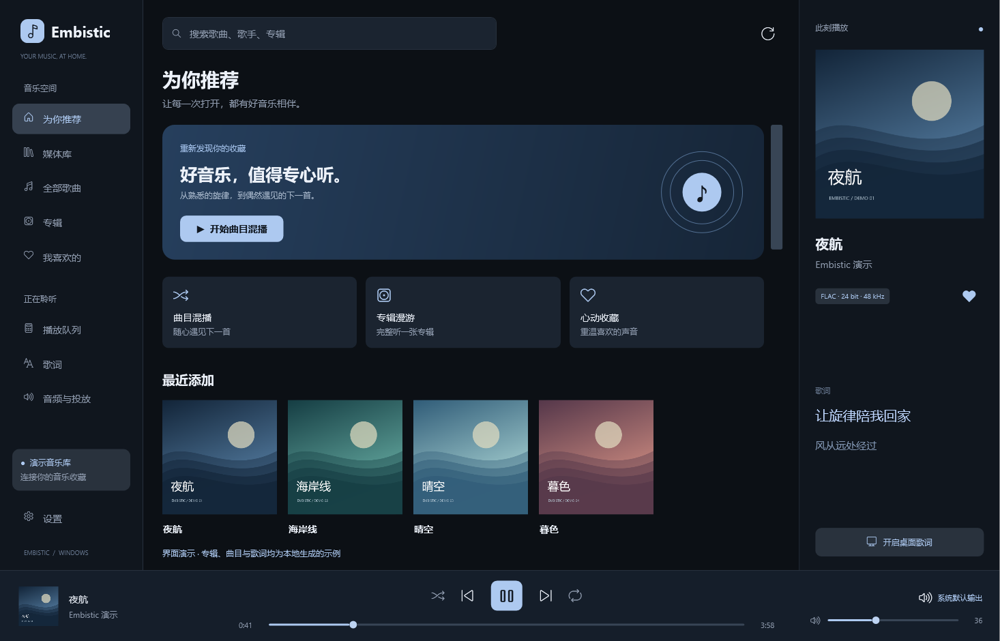
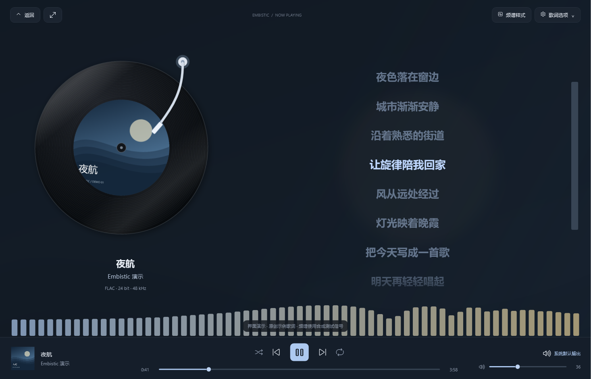

# Embistic

一个以听歌为主的 Windows Emby 客户端。连接自己的音乐库，在电脑上播放，也可以投放到局域网音箱。支持沉浸歌词、桌面歌词、音频频谱和外观自定义。

本项目代码由 AI 完成，欢迎通过 [Issues](https://github.com/Mr-Goodname/Embistic/issues) 反馈使用中遇到的问题。





## 下载与登录

在 [Releases](https://github.com/Mr-Goodname/Embistic/releases/latest) 下载 Windows x64 版本：

- **安装版**：运行 `Embistic-版本号-setup.exe`，按提示安装到当前用户目录。
- **免安装版**：解压 `Embistic-win-x64.zip`，打开其中的 `Embistic.exe`。请保留整个文件夹。

发行包包含 .NET 和 libVLC，无需另外安装运行时或 VLC。

首次打开后进入「设置」，填写 Emby 服务器地址，再选择登录方式：

- **账号密码**：使用自己的 Emby 用户名和密码登录。
- **API 密钥**：输入密钥，读取服务器用户并选择使用的账号。

程序不附带服务器地址、账号或密钥。密码不保存在本机；登录令牌或 API 密钥通过 Windows DPAPI 加密，保存在 `%LOCALAPPDATA%\Embistic\settings.json`，仅当前 Windows 用户可解密。

## 音乐库与播放

- 浏览歌曲、专辑、艺术家、专辑艺术家、流派、年份、作曲家、合辑和厂牌；部分分类取决于服务器提供的音乐元数据。
- 按 Emby 文件夹层级找歌，查看目录中的曲目，或播放整个文件夹。
- 首页显示最近添加、收藏专辑，以及最近、最常播放的歌曲和专辑。可调整首页模块和媒体库分类的显示与顺序。
- 全库搜索、收藏同步、曲目混播、随机完整专辑、播放队列、下一首播放、列表循环和单曲循环。
- 浏览和创建 Emby 播放列表，将当前歌曲或队列加入列表。
- 将 Emby 歌曲保存到此电脑，也可以添加自己的 HTTP / HTTPS 网络电台。
- 播放 FLAC 等 libVLC 支持的格式，显示音质信息，向 Emby 回报播放进度。

双击歌曲播放当前页面的队列；「播放全部」与「随机播放」读取当前筛选的完整结果。右键歌曲可立即播放、下一首播放或收藏，行尾的 `+` 用于加入队列。

底部控制条包含播放进度、音量和输出设备。点击封面进入沉浸歌词，右键封面可以查看歌曲信息、跳转专辑或艺术家、加入播放列表及下载歌曲。空格控制播放与暂停，编辑输入框时不会拦截空格。

## 输出设备与 DLNA

点击播放条的输出按钮，在弹出面板中选择本机扬声器、耳机或 USB 音频设备，也可以搜索同一局域网的 DLNA 音箱并投放当前歌曲。无需离开正在浏览的页面。

投放后仍可控制播放、暂停、进度和音量，也能切回本机。音箱直接从 Emby 获取音频，因此音箱必须能访问服务器地址。格式支持取决于音箱，本版不会自动为 DLNA 转码。

本机音频使用 Windows 共享模式，暂不支持 WASAPI 独占、ASIO 或位完美输出。更多说明见 [DLNA 使用说明](docs/dlna.md)。

## 歌词、频谱与主题

沉浸歌词页提供封面背景、唱片、同步滚动和歌词切换过渡。双击同步歌词可跳转播放进度，手动滚动后可回到当前句。

桌面歌词支持拖动、置顶、鼠标穿透，以及单行、下一句和翻译布局。「样式与动效」可以调整字体、字重、字号、对齐、文字颜色、阴影、背景透明度、窗口宽度和动画速度，并实时预览。锁定后可从主窗口的设置中解除鼠标穿透。

歌词获取顺序为手动导入的 LRC、Emby 歌词，以及缓存和网络匹配。网络歌词来自 [LRCLIB](https://lrclib.net/) 和网易云公开歌词接口，匹配会参考歌曲、歌手和时长。歌词可能缺失、超时或版本不符，可导入自己的 LRC，并调整时间偏移；正偏移表示歌词提前。歌词版权归原权利人所有，发行包不附带歌词内容。

频谱支持柱状、镜像、波形和折线，可设置频段、数量、高度、灵敏度、平滑度、颜色、透明度、辉光与帧率。数据来自所选 Windows 输出设备的音频回环采集，因此同一设备上其他程序的声音也可能进入频谱；DLNA 播放时无法读取音箱端的音频，频谱会停止。

主题提供亮色、暗色、跟随系统，以及自定义强调色或跟随 Windows 强调色。界面、歌词和频谱设置可导出备份，备份文件不包含 Emby 登录凭据。

## 更新与本地数据

「设置 → 检查更新」会读取公开 GitHub Release，显示版本说明并打开安装包或免安装版的下载链接；也可开启启动时检查更新。更新检查不需要 GitHub 令牌，不会自动安装软件。

设置、歌词缓存、播放记录和下载音乐保存在 `%LOCALAPPDATA%\Embistic`。安装版卸载时保留这些数据。关闭主窗口会停止播放，重新打开不会自动出声。

当前尚未提供均衡器、无缝播放或 ReplayGain。

## 开发与打包

技术栈为 C# / .NET 10、WPF、libVLC 和 NAudio。构建需要 Windows x64 与 .NET 10 SDK，在项目目录运行：

```powershell
powershell -ExecutionPolicy Bypass -File tools/build.ps1
powershell -ExecutionPolicy Bypass -File tools/test.ps1 -IncludeMedia
powershell -ExecutionPolicy Bypass -File tools/build.ps1 run --project tests/lyrics/LyricsTests.csproj
powershell -ExecutionPolicy Bypass -File tools/build.ps1 run --project tests/dlna/DlnaChecks.csproj
powershell -ExecutionPolicy Bypass -File tools/build.ps1 run --project tests/auth/AuthChecks.csproj
powershell -ExecutionPolicy Bypass -File tools/build.ps1 run --project tests/library/LibraryChecks.csproj
powershell -ExecutionPolicy Bypass -File tools/build.ps1 run --project tests/updates/UpdateChecks.csproj
powershell -ExecutionPolicy Bypass -File tools/package.ps1
```

`tools/test.ps1` 依次运行登录、更新、媒体库、歌词、DLNA 协议、外观、动效、主题和频谱检查；加上 `-IncludeMedia` 会同时运行媒体播放检查。单个检查项目也可使用上面的 `build.ps1 run` 命令运行。实体 DLNA 测试需另行显式指定目标设备，不包含在此测试集合中。

`tools/build.ps1` 在 SDK 完整时直接调用 `dotnet`；检测到缺失的官方 targets 文件时，仅在项目的 `artifacts` 目录建立兼容覆盖，不修改系统 SDK。

免安装包生成在 `dist` 目录。安装包使用本机已安装的 Inno Setup 编译器：

```powershell
powershell -ExecutionPolicy Bypass -File tools/build-installer-local.ps1 -Version 0.3.1
```

该脚本不会下载或安装编译器。仓库的 Release 工作流也可在 `vX.Y.Z` 标签上构建 Windows 安装版、免安装版和 SHA-256 校验文件。

第三方组件、来源及许可证见 [THIRD_PARTY_NOTICES.md](THIRD_PARTY_NOTICES.md)。
